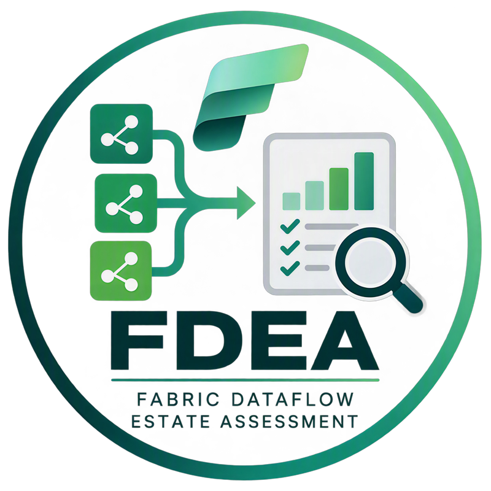
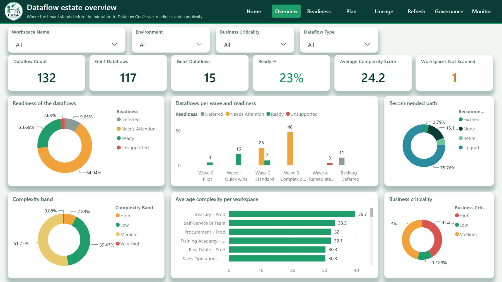
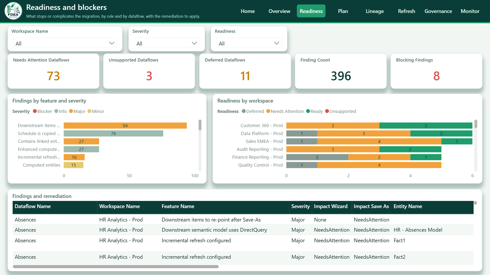
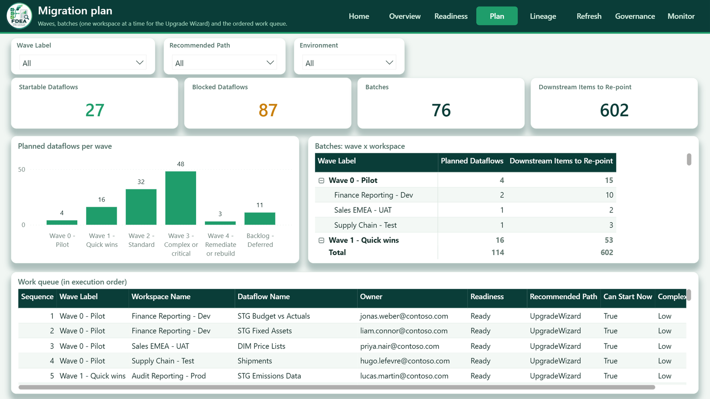
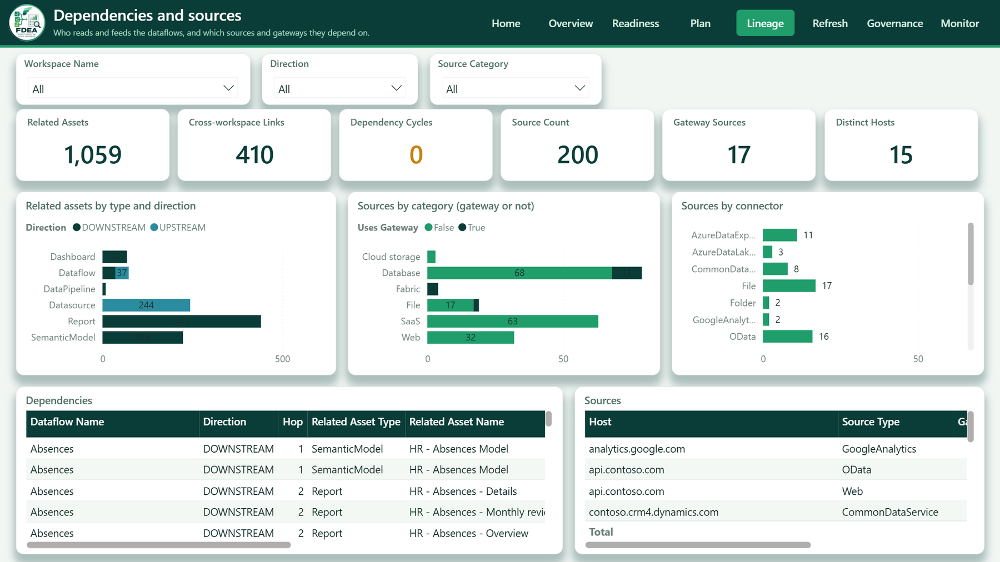
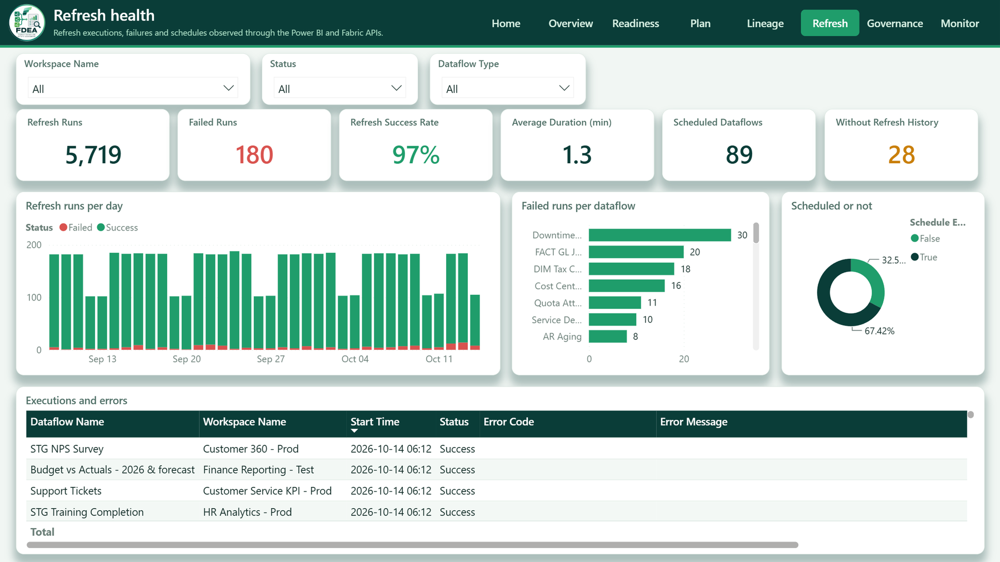
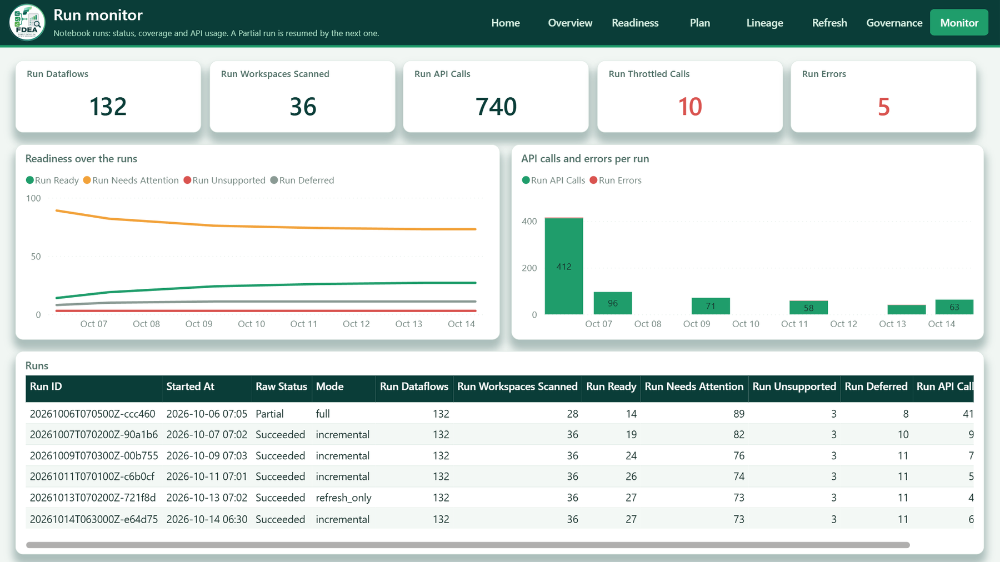
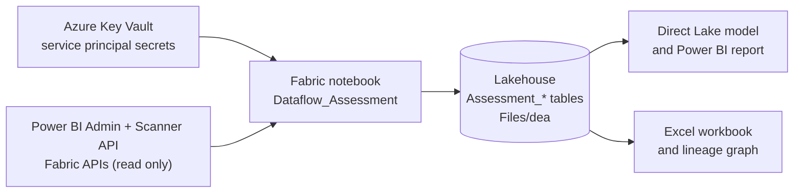
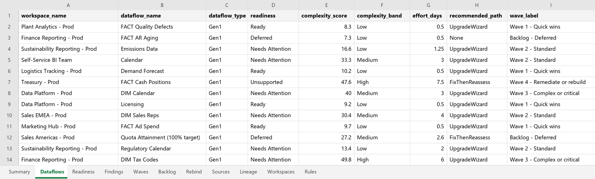

  

<h1 align="center">Fabric Dataflow Estate Assessment (FDEA)</h1>

  <strong>FDEA is a Microsoft Fabric notebook that inventories every Power BI Dataflow Gen1 and Fabric Dataflow Gen2
  of a tenant and turns it into a migration plan towards Dataflow Gen2: readiness, complexity, effort, path and wave
  for each dataflow.</strong>

  

> [!CAUTION]
> This is a community reference implementation. It is **not an official Microsoft product**, is not supported by Microsoft, and there is a risk that things might break as Microsoft APIs evolve. See the [disclaimer](#license-and-disclaimer).

The <em>Overview</em> page of the FDEA report. All the screenshots and samples use fictitious data (a Contoso-style tenant), see <a href="#sample-outputs">Sample outputs</a>.

**Contents:**
[Why FDEA](#why-fdea) ·
[See it in action](#see-it-in-action) ·
[Get started](#get-started) ·
[How it works](#how-it-works) ·
[Sample outputs](#sample-outputs) ·
[What is assessed](#what-is-assessed) ·
[Migration options](#migration-options) ·
[Related solutions](#related-solutions) ·
[Limitations](#limitations) ·
[Security and privacy](#security-and-privacy) ·
[Documentation](#documentation) ·
[Credits](#credits) ·
[License and disclaimer](#license-and-disclaimer)

## Why FDEA

Migrating a large estate of dataflows to Gen2 raises the same questions in every tenant: which dataflows exist, who owns them, what do they depend on, which ones are ready, which ones need work, and in which order should they move? The answers are scattered across several admin and workspace APIs, and the APIs are throttled.

FDEA started from a real customer scenario with hundreds of Gen1 dataflows. The approach is generic, so it has been generalized and shared as community IP. Adapt the rules, scoring and reports to your own needs, and feedback is welcome through GitHub issues.

* **One inventory for the whole tenant.** Gen1 and Gen2 dataflows with owner, capacity, schedule, refresh history, data sources, gateways and lineage to downstream models and reports.
* **Explainable verdicts.** Every finding comes from a [catalog of 29 rules](docs/rule-catalog.md) with evidence, remediation and effort, for both the Upgrade Wizard and Save-As.
* **A plan, not just a list.** Readiness class, 0-100 complexity score, effort in person-days, recommended path, dependency-ordered waves and a worklist of consumers to re-point.
* **Safe to run on a large tenant.** Checkpoints, incremental Scanner scans, API budgets and `429` handling: a run that stops early is simply run again.
* **Read-only.** The notebook writes nothing to your tenant, only to the Lakehouse attached to it.
* **One notebook.** No local tooling: import it into Fabric and run it.

## See it in action

The notebook writes its results to Delta tables, and the Power BI project in this repository turns them into a report: a home page with the analysis paths, followed by seven pages. The screenshots below come from a fictitious estate of 132 dataflows in 36 workspaces.

**Decide what stops the migration.** Every finding comes from a rule, with its severity, its effect on the Upgrade Wizard and on Save-As, the entity concerned and the remediation to apply.

**Plan the waves.** A pilot, quick wins, standard, complex and remediation waves, batches of one workspace at a time for the Upgrade Wizard, and the ordered work queue with the dataflows that can start now.

**Know who depends on what.** Upstream and downstream assets, cross-workspace links, data sources, gateways and connectors, so that no semantic model or report is broken by surprise.

**Spot the failing dataflows.** Refresh runs per day by status, failures per dataflow, schedules, and the latest executions with their error messages.

**Check the coverage of the notebook.** One row per run, the readiness trend over the runs and the API usage, so you know whether the whole tenant was scanned.

The *Home* and *Governance* pages are shown in [docs/06-power-bi-report.md](docs/06-power-bi-report.md).

## Get started

You deploy FDEA by importing one notebook into a Fabric workspace. The [runbook](docs/04-runbook.md) details each step and every parameter.

### 1. Prepare an identity

Use a **service principal** (recommended) with its tenant id, client id and secret stored in **Azure Key Vault**, or run the notebook as a **Fabric administrator** (`p_auth_mode = "user"`). For a service principal, enable *Service principals can access read-only admin APIs* and *Service principals can call Fabric public APIs* for a security group containing it, and do **not** grant admin-consent Power BI API permissions to the app.
[Details](docs/04-runbook.md#service-principal-and-tenant-settings)

### 2. Import the notebook

Download [`notebooks/Dataflow_Assessment.ipynb`](notebooks/Dataflow_Assessment.ipynb), import it into a Fabric workspace, and attach a **Lakehouse** as its default Lakehouse (schema-enabled recommended).

### 3. Set the identity

In the first cell, set `p_key_vault_url = "https://<your-vault>.vault.azure.net/"`. The secret names default to `dea-tenant-id`, `dea-client-id` and `dea-client-secret`. Skip this when using `p_auth_mode = "user"`.

### 4. Try it on a small scope

Set `p_dry_run = True` and `p_only_workspaces = "<workspace name or id>"`, then select **Run all**. Nothing is written to the Lakehouse.

### 5. Run it for real

Set `p_dry_run = False`, clear `p_only_workspaces`, and run with `p_run_mode = "full"`. Then schedule `incremental` runs ([run modes and scheduling](docs/04-runbook.md#4-run-modes)).

Results are in the Lakehouse tables `Assessment_*` (start with `Assessment_DataflowSummary`) and in `Files/dea/reports/<run id>/` (summary, Excel workbook, lineage graph). The last cell prints the status of the run: `Succeeded`, `Partial` (run it again) or `Failed` (see `Assessment_ErrorLog` and the [troubleshooting table](docs/04-runbook.md#9-troubleshooting)).

For the optional Power BI report, see [Power BI report](#power-bi-report).

## How it works

The notebook reads the Power BI and Fabric APIs, builds the inventory in Delta tables, and runs the analysis on top of it. The Scanner API is used first, because one call describes up to 100 workspaces; per-item APIs are only used for what it cannot tell.

| Component | What it does |
|---|---|
| Notebook ([notebooks/Dataflow_Assessment.ipynb](notebooks/Dataflow_Assessment.ipynb)) | Ten sections: configuration, authentication, workspace and dataflow discovery, definitions and dependencies, refresh history, readiness analysis, Delta persistence, reporting, monitoring. Every setting is a `p_` parameter in the first cell |
| Lakehouse tables ([sql/lakehouse_ddl.sql](sql/lakehouse_ddl.sql)) | 20 `Assessment_*` tables: inventory, lineage, findings, readiness, wave plan, backlog, rebind worklist and run monitoring. Described in the [data dictionary](docs/data-dictionary.md) |
| Assessment framework | Rules, complexity score, effort and waves, described in the [assessment framework](docs/03-assessment-framework.md). Weights and thresholds can be tuned and re-applied with `p_run_mode = "analysis_only"`, without any API call |
| Power BI project ([powerbi/](powerbi)) | A Direct Lake semantic model and a report (home page plus seven analysis pages) over the tables |

More in the [architecture](docs/01-architecture.md).

### Power BI report

A *Home* page with the key figures and navigation tiles, then *Overview*, *Readiness*, *Plan*, *Lineage*, *Refresh*, *Governance* and *Monitor*, all with the FDEA theme and a navigation bar. Before opening `powerbi/DataflowAssessment.pbip` in Power BI Desktop, edit [`expressions.tmdl`](powerbi/DataflowAssessment.SemanticModel/definition/expressions.tmdl) and replace the `<workspace-id>` and `<lakehouse-id>` placeholders in the OneLake URL with the ids of your workspace and Lakehouse (the semantic model reads the tables of the `dbo` schema). Details: [docs/06-power-bi-report.md](docs/06-power-bi-report.md).

## Sample outputs

Each run also writes a summary and an Excel workbook under `Files/dea/reports/<run id>/`, next to the lineage graph (Mermaid and DOT, plus SVG when the `dot` binary is available). The samples below were produced by the notebook's own code on the fictitious estate: [docs/samples/summary.md](docs/samples/summary.md) and [docs/samples/dataflow_assessment.xlsx](docs/samples/dataflow_assessment.xlsx).

### Summary

An excerpt of `summary.md`, the one-page view for a steering committee:

> **Inventory**
>
> | Capacities | Workspaces | With dataflows | Dataflows | Gen1 | Gen2 | Unknown |
> |---|---|---|---|---|---|---|
> | 3 | 36 | 35 | 132 | 117 | 15 | 0 |
>
> **Migration progress.** 9 migrated, 114 remaining (7.3 % of 123); 1 Save-As failures. Estimated remaining effort: **274.6 person-days**, average complexity 24.2.
>
> **Readiness of the remaining Gen1 dataflows**
>
> | Readiness | Dataflows | Share % |
> |---|---|---|
> | Ready | 27 | 23.7 |
> | Needs Attention | 73 | 64.0 |
> | Unsupported | 3 | 2.6 |
> | Deferred | 11 | 9.6 |
>
> **Migration waves**
>
> | Wave | Label | Dataflows | Workspaces | Ready | Needs Attention | Unsupported | Deferred | Effort (days) |
> |---|---|---|---|---|---|---|---|---|
> | 0 | Wave 0 - Pilot | 4 | 3 | 4 | 0 | 0 | 0 | 2.0 |
> | 1 | Wave 1 - Quick wins | 16 | 13 | 16 | 0 | 0 | 0 | 8.0 |
> | 2 | Wave 2 - Standard | 32 | 25 | 7 | 25 | 0 | 0 | 70.0 |
> | 3 | Wave 3 - Complex or critical | 48 | 24 | 0 | 48 | 0 | 0 | 165.8 |
> | 4 | Wave 4 - Remediate or rebuild | 3 | 1 | 0 | 0 | 3 | 0 | 20.2 |
> | 99 | Backlog - Deferred | 11 | 10 | 0 | 0 | 0 | 11 | 8.6 |
>
> **Most frequent findings**
>
> | Rule | Finding | Severity | Category | Dataflows | Share % |
> |---|---|---|---|---|---|
> | REB-001 | Downstream items to re-point after Save-As | Major | Lineage | 94 | 82.5 |
> | LNK-001 | Contains linked entities | Major | Lineage | 27 | 23.7 |
> | INC-001 | Incremental refresh configured | Major | Refresh | 16 | 14.0 |
> | CMP-001 | Computed entities | Minor | Transform | 15 | 13.2 |
> | GW-001 | Source through a data gateway | Minor | Connectivity | 14 | 12.3 |

The full file also lists the predicted Upgrade Wizard assessment, the recommended paths, the complexity bands, the most complex dataflows and the dataflows with the highest downstream impact.

### Excel workbook

`dataflow_assessment.xlsx` is the working file of the migration team: filters and a frozen header on every sheet, one row per dataflow, finding, batch or lineage edge.

| Sheet | Content |
|---|---|
| `Summary` | The KPIs of the run |
| `Dataflows` | One row per dataflow: owner, refresh health, counts, readiness, complexity, effort, path and wave |
| `Readiness` | The same verdicts with their reasons, predicted Upgrade Wizard status and confidence |
| `Findings` | One row per finding, with the rule, evidence, remediation and effort |
| `Waves`, `Backlog` | The wave plan and the ordered work queue (what can start now, what blocks it, actions before and after) |
| `Rebind` | The consumers to re-point after a Save-As |
| `Sources`, `Lineage`, `Workspaces`, `Rules` | Data sources and gateways, lineage edges, workspaces and capacities, and the rule catalog |

### About the sample data

The input tables were invented: a Contoso-style tenant of 132 dataflows in 36 workspaces, with gateways, linked dataflows, incremental refresh, bring-your-own storage, failing and stale dataflows, Save-As results and a governance file. The analysis, the KPIs, the summary, the workbook and the report are the real ones. The run history (API calls, workspaces scanned per run) is illustrative, as no API was called.

## What is assessed

| | |
|---|---|
| **Supported** | Power BI **Dataflow Gen1** and Fabric **Dataflow Gen2** items, as inventory. The migration verdicts target a Gen1 to Gen2 migration |
| **Not in scope** | Dataflow Gen2 CI/CD specifics, and GCC tenants (the Upgrade Wizard is not available there) |
| **Not assessed** | Data volumes and row counts (no API), and consumers that are not Power BI or Fabric items known to the Scanner: notebooks, external applications, Excel files, Power Automate flows |

| Collected | Where |
|---|---|
| Workspace, capacity, owner, type, dates, tags | `Assessment_DataflowSummary`, `Assessment_Dataflows`, `Assessment_Workspaces`, `Assessment_Capacities` |
| Last refresh, status, duration, schedule, errors | `Assessment_Dataflows`, `Assessment_RefreshHistory` |
| Data sources, gateways, credential types | `Assessment_DataflowSources` |
| Queries, entities, functions, parameters, incremental refresh, unsupported features | `Assessment_Dataflows`, `Assessment_UnsupportedFeatures` |
| Upstream and downstream dependencies, lineage | `Assessment_DataflowDependencies`, `Assessment_Lineage`, `Assessment_LineageNodes`, `Assessment_RebindWorklist` |
| Readiness, recommendation, waves | `Assessment_MigrationReadiness`, `Assessment_WavePlan`, `Assessment_MigrationBacklog` |

An optional governance CSV (`Files/dea/config/governance_overrides.csv`) adds business owner, criticality, environment, deferrals and pinned waves ([format](docs/04-runbook.md#6-governance-overrides-csv), [template](config/governance_overrides.sample.csv)).

## Migration options

FDEA's verdicts target the two migration paths Microsoft provides for Gen1 dataflows: the **Upgrade Wizard** (in place, keeps the dataflow id, preview) and **Save As** (a new Gen2 copy, the Gen1 dataflow stays). When the wizard is not an option for a dataflow, Microsoft's [migration scenarios](https://learn.microsoft.com/fabric/data-factory/dataflow-gen2-migrate-from-dataflow-gen1-scenarios) describe other approaches:

| Option | Typical use |
|---|---|
| **Save As** | The wizard is unavailable or unsuitable, or the Gen1 dataflow must be kept |
| **Power Query template** | Rebuild a dataflow that neither path accepts: export the queries, import them into a new Gen2 |
| **Re-point consumers** | Personal or team dataflows: update the dataflow ids in existing semantic models and Excel files |
| **OneLake shortcuts** | Linked tables across workspaces: output to a Lakehouse and read it with `Lakehouse.Contents` |
| **Warehouse output** | Shared tables that need row-level or column-level security |

FDEA models the first path of each pair as `UpgradeWizard` and `SaveAs`, and falls back to `ManualRebuild`; the other options are applied by hand from the findings. Details and trade-offs: [docs/03-assessment-framework.md](docs/03-assessment-framework.md#alternatives-to-the-upgrade-wizard).

## Related solutions

FDEA decides **what** to migrate, **how** and **when**. Microsoft's [DFG2 migration accelerator](https://github.com/microsoft/fabric-toolbox/tree/main/accelerators/DFG2-migration-accelerator), in the Fabric Toolbox, **executes** the Save-As migration. They are complementary and share the same Lakehouse conventions.

| | DFG2 migration accelerator | **FDEA** (this repository) |
|---|---|---|
| **Role** | Inventory, Save-As conversion and re-pointing of downstream items | Assessment, scoring, wave planning and rebind worklist |
| **Decision support** | None: no readiness, complexity, effort or waves | Readiness class, complexity score, effort, recommended path, waves |
| **Throttling and restart** | Plain API calls, full re-inventory on each run | Rate-limit buckets, checkpoints, incremental scans |
| **Data model** | Tables overwritten at each run, columns stored as strings | Typed tables with history and soft deletes |
| **Status** | Solution accelerator maintained in `microsoft/fabric-toolbox` | Community project |

After a Save-As, the results table of the accelerator (`p_migration_results_table`, default `dataflowmigrations`) is read by the next FDEA run, so migrated dataflows drop out of the plan. The review, based on a specific version of the accelerator, is in [docs/05-accelerator-review.md](docs/05-accelerator-review.md).

## Limitations

* **The Upgrade Wizard has no API.** Its verdict is predicted by the rules and should be calibrated on a sample of workspaces ([calibration](docs/03-assessment-framework.md#7-calibration)).
* **Linked dataflows and refresh order.** In Gen1, refreshing a source dataflow refreshes its dependents automatically only when they are in the same workspace; links across workspaces do not cascade. Dataflow Gen2 does not cascade at all, so chain the refreshes of migrated dataflows with a pipeline or schedules ([details](docs/03-assessment-framework.md#linked-dataflows-and-the-refresh-cascade)).
* **Some data needs workspace membership.** Gen1 refresh history, and definitions read through the workspace API, need the identity to be a workspace member. Without it, FDEA records `AccessDenied` and lowers the confidence of the verdict instead of failing.
* **Some behaviours are not documented by Microsoft.** Gen2 `getDefinition` for service principals is documented inconsistently (off by default), and `computeEngineBehavior` values are interpreted defensively. Rules marked `Heuristic` in the [rule catalog](docs/rule-catalog.md) infer limitations from indirect signals, and the M analysis is lexical, not a full parser.
* **Scale.** The analysis runs on the Spark driver in plain Python and is sized for tens of thousands of dataflows.
* **Throttling.** On a large tenant the first harvest can take several runs: the Gen1 definition export through the admin API is capped at 200 requests per hour ([scale and scheduling](docs/04-runbook.md#5-scale-throttling-and-scheduling)).
* **Manual steps remain:** the tenant settings, the identity and the Power BI model's workspace and Lakehouse ids.

The full list is in the [runbook](docs/04-runbook.md#11-known-limitations).

## Security and privacy

* **What is stored.** Workspace, dataflow and data source names, owner and admin user principal names, and the definitions-derived facts used by the rules. Raw Scanner JSON is kept in `Files/dea/raw` for `p_raw_retention_days` days (30 by default).
* **Where it is stored.** Only in the Lakehouse you attach to the notebook. Restrict access to it (workspace roles, OneLake security) and protect the governance CSV.
* **Secrets.** Only Key Vault secret *names* are parameters. Secrets are read with `notebookutils.credentials.getSecret`, tokens stay in memory and are not logged, and error bodies are truncated before they are stored.
* **Permissions.** Read-only admin APIs. Workspace membership and Microsoft Graph `User.Read.All` are optional and only needed by the collectors that use them. Nothing in the notebook modifies the tenant.
* **Your responsibility.** You run FDEA in your own tenant. Securing the workspace and the identity, and complying with your organization's data policies, remain your responsibility.

## Documentation

| Document | Content |
|---|---|
| [01-architecture.md](docs/01-architecture.md) | Architecture, API usage, incremental design, security |
| [02-lakehouse-model.md](docs/02-lakehouse-model.md) | Tables, Direct Lake model, example queries |
| [03-assessment-framework.md](docs/03-assessment-framework.md) | Readiness matrix, scoring, effort, waves |
| [04-runbook.md](docs/04-runbook.md) | Prerequisites, parameters, run modes, scheduling, troubleshooting |
| [05-accelerator-review.md](docs/05-accelerator-review.md) | Relationship with the Microsoft DFG2 accelerator |
| [06-power-bi-report.md](docs/06-power-bi-report.md) | Semantic model and report |
| [data-dictionary.md](docs/data-dictionary.md), [rule-catalog.md](docs/rule-catalog.md) | Generated reference |

## Credits

* **The Microsoft [DFG2 migration accelerator](https://github.com/microsoft/fabric-toolbox/tree/main/accelerators/DFG2-migration-accelerator)** in the [Fabric Toolbox](https://github.com/microsoft/fabric-toolbox). FDEA adopted its Scanner-first discovery with the real payload fields, its Save-As semantics and its results table, as described in the [review](docs/05-accelerator-review.md).
* **Microsoft documentation** for the Power BI REST and Scanner APIs, the Fabric REST APIs and Dataflow Gen2.

## License and disclaimer

FDEA is released under the [MIT License](LICENSE).

FDEA is a community reference implementation. It is **not an official Microsoft product**, is not affiliated with or endorsed by Microsoft, and comes with no official support. It does not replace official Microsoft documentation, guidance or support. It is provided "as is", without warranties or guarantees. You are responsible for validating it against your own security, compliance, governance, performance and production requirements before use. Microsoft product behavior and APIs evolve: refer to the official Microsoft documentation for authoritative information.

Microsoft, Power BI, Microsoft Fabric and Azure are trademarks of the Microsoft group of companies.
