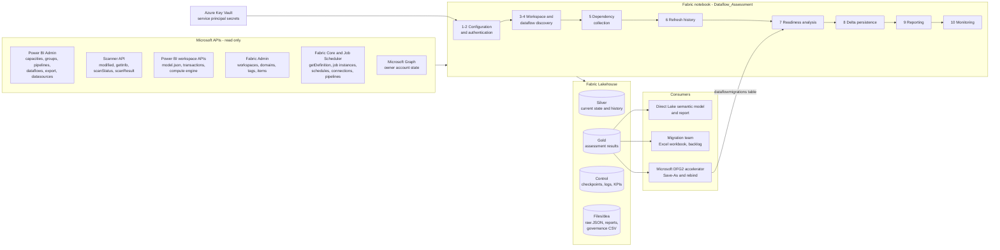
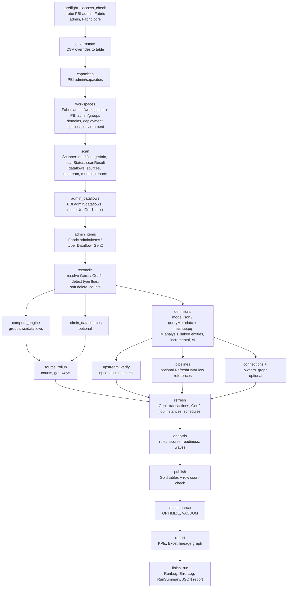
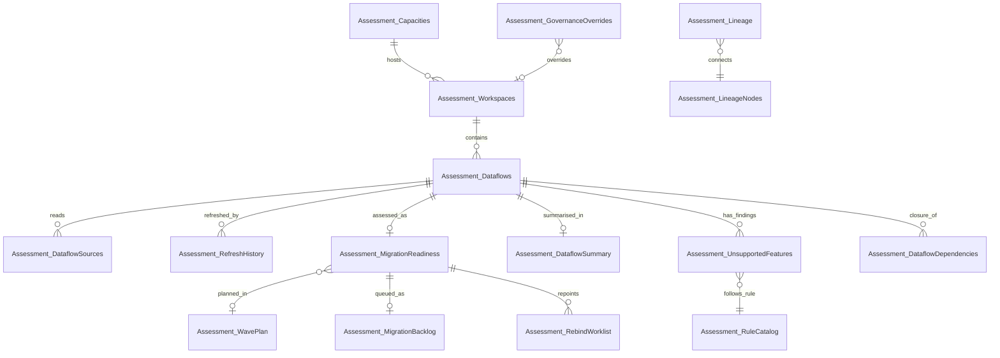

# Architecture

Dataflow Estate Assessment (DEA) inventories every Power BI Dataflow Gen1 and Fabric Dataflow Gen2 of a tenant, stores a dimensional
model in a Fabric Lakehouse, and turns it into a migration plan: readiness class, complexity score, effort, recommendation and wave
per dataflow. This document describes the solution; [02-lakehouse-model.md](02-lakehouse-model.md) details the storage,
[03-assessment-framework.md](03-assessment-framework.md) the assessment logic, [04-runbook.md](04-runbook.md) the operation and
[05-accelerator-review.md](05-accelerator-review.md) the relationship with the Microsoft DFG2 migration accelerator.

## 1. High-level architecture



Design principles

| Principle | How it shows up |
|---|---|
| **Scanner first** | One Scanner call describes 100 workspaces (dataflows, owners, schedules, data sources, upstream dataflows, semantic models, reports, dashboards). It is the cheapest source by far and supports incremental scans (`modifiedSince`). Deeper, per-item APIs are only used for what it cannot tell. |
| **Pure analysis** | Readiness, scoring and waves are a pure function of the Silver tables (`run_analysis`). It can be re-run alone (`analysis_only`), unit-tested without Spark, and tuned without touching the tenant. |
| **Every limit is a parameter** | Documented quotas (admin 200 requests/hour, Scanner 500 `getInfo`/hour and 16 concurrent scans, Fabric 500/min ...) live in one table and are scaled by `p_rate_limit_scale`; per-run API budgets bound each collector. |
| **Restartable by construction** | Each collector records a checkpoint per entity and entity version, persists after every micro-batch and stops gracefully on the deadline, the budget or exhausted throttling. The next run resumes where it stopped. |
| **Best effort, never silent** | Missing permissions degrade the evidence (`AccessDenied`, `NotAttempted`, lower `assessment_confidence`, rule `DAT-001`), never the run. |
| **Two migration paths** | Rules carry a separate effect for the **Upgrade Wizard** (in place, keeps the id) and **Save-As** (new id, API-driven) because Microsoft treats them differently. |

## 2. Notebook structure

The notebook is generated from percent-format sources (`notebooks/src/*.py`) by `tools/build_notebook.py`; each source file is one or
two sections. Every section ends with a small *run cell* (`run_steps(ctx, sections={n})`) so the notebook runs top to bottom,
as a pipeline activity, or section by section.

| # | Section | Source file(s) | Steps (run mode `incremental`) | Main outputs |
|---|---|---|---|---|
| 1 | Configuration | `00_overview_and_parameters`, `01_a..f` | parameters, schema registry (20 tables), rule catalog (29 rules), run context, logging, storage layer, orchestration | - |
| 2 | Authentication | `02_auth_http` | `preflight`, `access_check` | access matrix |
| 3 | Workspace discovery | `03_workspaces` | `governance`, `capacities`, `workspaces`, `scan` | Capacities, Workspaces, partly Dataflows, Sources, Lineage |
| 4 | Dataflow discovery | `04_dataflows` | `admin_dataflows`, `admin_items`, `reconcile` | Dataflows (type, storage, deletions) |
| 5 | Dependency collection | `05_a_definitions`, `05_b_dependencies` | `definitions`, `compute_engine`, `admin_datasources`, `upstream_verify`, `pipelines`, `connections`, `owners_graph`, `source_rollup` | Dataflows (complexity facts), Sources, Lineage |
| 6 | Refresh history | `06_refresh` | `refresh` | RefreshHistory, Dataflows (health, schedule) |
| 7 | Migration readiness analysis | `07_a..d` | `analysis` | Gold tables in memory |
| 8 | Delta persistence | `08_publish` | `publish`, `maintenance` | Gold tables, OPTIMIZE |
| 9 | Reporting output | `09_report` | `report` | KPIs, Excel workbook, lineage graph |
| 10 | Logging and monitoring | `10_monitor` | `finish_run` | RunLog, ErrorLog, RunSummary, run report |

Run modes: `incremental` (default), `full`, `resume`, `refresh_only`, `analysis_only` (see the [runbook](04-runbook.md#4-run-modes)).

## 3. Data collection workflow



Scanner exchange (Section 3), with the documented limits that shape it

```mermaid
sequenceDiagram
    participant N as Notebook
    participant S as Power BI Scanner
    N->>S: GET admin/workspaces/modified (modifiedSince, 30/h)
    S-->>N: ids of modified workspaces
    loop batches of 100, at most 16 in flight (getInfo 500/h)
        N->>S: POST admin/workspaces/getInfo
        S-->>N: 202 + scan id
        N->>S: GET scanStatus (poll)
        S-->>N: Succeeded
        N->>S: GET scanResult (500/h, expires after 24 h)
        S-->>N: workspaces, dataflows, datasets, reports, ...
        N->>N: parse, merge Silver, checkpoint, keep raw JSON
    end
    Note over N: a failed batch is retried as two halves (budget 40 per run); a requested workspace missing from a result is marked Failed and retried
    Note over N: the watermark only advances after a COMPLETE scan of the same scope and Scanner flags
```

### API usage

| Phase | API | Why | Quota that applies |
|---|---|---|---|
| preflight | PBI `admin/capacities`, Fabric `admin/tags`, `capacities` | access matrix, hints for missing tenant settings | - |
| capacities | PBI `admin/capacities` (fallback Fabric `capacities`) | SKU, region, Fabric capability (Fabric admin has **no** capacities endpoint) | 200/h |
| workspaces | Fabric `admin/workspaces`, `admin/domains`; PBI `admin/groups`, `admin/pipelines` | state, capacity, domain, attached storage (`dataflowStorageId`), deployment stage (environment) | admin 200/h, `admin/groups` 50/h and 15/min with `$top` mandatory, domains 25/min |
| scan | PBI `admin/workspaces/modified`, `getInfo`, `scanStatus`, `scanResult` | bulk metadata and lineage | 30/h, 500/h (max 16 concurrent), 10 000/h, 500/h |
| admin_dataflows | PBI `admin/dataflows` | `modelUrl` (BYOSA indicator), authoritative Gen1 id list | 200/h |
| admin_items | Fabric `admin/items?type=Dataflow` | Gen2 inventory, creator, tags (10 000 per page) | 200/h |
| definitions | PBI `admin/dataflows/{id}/export` (fallback `groups/{ws}/dataflows/{id}`); Fabric `getDefinition` (LRO, Gen2, optional) | M analysis, linked entities, incremental refresh, AI functions, native queries | 200/h on the admin export; `getDefinition` needs read and write on the item |
| compute_engine | PBI `groups/{ws}/dataflows` | enhanced compute engine setting (not in the admin payload) | workspace membership |
| admin_datasources, upstream_verify | PBI `admin/dataflows/{id}/datasources`, `.../upstreamDataflows` | optional completion and cross-check of the Scanner | 200/h |
| pipelines | Fabric `admin/items?type=DataPipeline`, `dataPipelines/{id}/getDefinition` | `RefreshDataFlow` activities (control dependencies) | platform 500/min |
| connections, owners_graph | Fabric `items/{id}/connections`, `gateways`; Microsoft Graph `users/{upn}` | credential type, gateway names, disabled owners | read+write on the item; Graph `User.Read.All` |
| refresh | PBI `groups/{ws}/dataflows/{id}/transactions`; Fabric `items/{id}/jobs/instances`, `jobs/{type}/schedules` | refresh history, durations, errors, schedules of Gen2 | job scheduler 200/min |

No API reads the refresh schedule of a Gen1 dataflow: it comes from the Scanner (`refreshSchedule`). Gen1 refresh history has no admin
variant (workspace membership needed); the notebook records `AccessDenied` and continues.

## 4. Incremental execution and restartability

| Mechanism | Detail |
|---|---|
| **Watermark** | Scanner watermark in `Assessment_Checkpoint` (`Tenant/scanner/scan`), advanced only after a **complete** scan: no failed batch and no requested active workspace missing from a result. It carries a fingerprint of the scope settings (`p_only_workspaces`, `p_exclude_workspaces`, `p_source_capacity`, `p_include_*`) and of the Scanner flags. When the fingerprint changes the scan restarts from scratch: every in-scope workspace is reset to `NotScanned` **before** a `Reset` checkpoint (which names the fingerprint it restarts for) replaces the old watermark, so a storage failure leaves the old checkpoint to be retried and the restart itself can be resumed, or restarted again when the settings change again. Without a usable watermark the oldest per-workspace `scanned_at` is used; a full scan runs when it is older than 28 days. |
| **What `Scanned` means** | "Current as of the watermark". What is stored for a workspace that is outside the scope (moved to another capacity, excluded, deleted) is not, so it is reset to `NotScanned` in the run that notices, and again when a deleted workspace is listed again: whenever such a workspace re-enters the scope it is scanned, nobody needs to have modified it. |
| **Scan completeness** | A batch the Scanner fails is retried as two halves (up to 40 splits per run), which isolates a single bad workspace: it is marked `scan_state = Failed` and retried by every run, its batch-mates are scanned. An **active** workspace requested but absent from a successful result is `Failed` too, the run is **Partial** and the watermark stays where it was. A workspace that is no longer active is legitimately absent (`NotScanned`, not a failure, the watermark advances); it is requested again by the next runs while `p_include_inactive_workspaces` is on. |
| **Per-entity checkpoints** | `(entity_type, entity_id, phase)` with status `Done`, `Failed`, `Denied`, `NotFound`, attempts, completion time and the **source version** (modification time or hash). A definition is read again only when the dataflow changed. |
| **TTL and retry back-off** | Refresh history is collected again after `p_refresh_history_ttl_hours`; denied entities retry after `p_denied_retry_days`; failed ones after `p_failed_retry_days` once `p_max_attempts_per_entity` is reached. |
| **Prioritisation** | New entities first, then changed, then retries, oldest first. |
| **Budgets and deadline** | `p_budget_*_per_run`, `p_max_runtime_minutes` (soft deadline) and `p_max_retry_after_sec` end a phase as **Partial** instead of failing. |
| **Micro-batch persistence** | Collectors flush to Delta every `p_batch_flush_size` entities, so a crash loses at most one batch. |
| **Idempotent writes** | MERGE by business key, partial-column updates (a phase only overwrites its own columns), soft deletes, snapshot overwrite for Gold. Re-running a run changes nothing. |
| **Cascading deletes** | When a workspace leaves the tenant listing, its dataflows, sources and lineage edges are flagged `is_deleted` with it (derived from the Lakehouse, so an interrupted run is repaired by the next one); they come back if the workspace returns. Only a workspace the listing could have contained counts: personal workspaces while `p_include_personal_workspaces` is off, and non-active ones while `p_include_inactive_workspaces` is off, are never taken for deleted just because the filtered listing (or an API that is denied) does not show them. |
| **Step dependencies** | A step that works on the output of another is skipped when that step did not complete: `publish` needs `analysis`, `maintenance` and `report` need `publish`. The Gold tables are never published from a failed analysis, and no report is built on them. |
| **Circuit breaker** | After 25 consecutive denied calls a collector stops instead of burning quota on a permission problem. |
| **Resume** | `p_run_mode = "resume"` with `p_resume_run_id` continues the run id (log sequence numbers carry on); the single KPI row of the run accumulates API calls, retries, throttling and errors over the attempts and keeps the original start time. Every attempt writes its own `runs/<run>.json` (`.attempt2.json`, ...). |

## 5. Throttling, retries and pagination

* **Client-side rate limiter.** Every call declares one or more *buckets* (`pbi_admin_dataflow_export`, `pbi_scan_getinfo`, `fabric_jobs` ...). Each bucket
  is a sliding window (calls, seconds) taken from the documentation and scaled by `p_rate_limit_scale` (default 0.9); the most restrictive bucket binds. Override
  with `p_rate_limit_overrides` (JSON) when a tenant has other limits.
* **Server-side throttling.** HTTP 429 and 503/504 are retried with exponential backoff and jitter (`p_retry_base_delay_sec`, `p_retry_max_delay_sec`,
  `p_max_retries`) and `Retry-After` is honoured. A wait longer than `p_max_retry_after_sec` ends the phase gracefully (Partial). 401 refreshes the token once.
* **Long-running operations** (Fabric `getDefinition`, pipeline definitions) follow `Location` / `x-ms-operation-id` with polling. `Retry-After` is honoured (the next poll is never earlier
  than asked) and the time spent waiting is bounded (10 minutes; no sleep goes past the limit); a succeeded operation whose result cannot be read, or an answer without a definition, is
  recorded as **Failed** and retried, never stored as collected.
* **Pagination.** `continuationUri` / `continuationToken` (Fabric, Admin items) and `$top` / `$skip` (Power BI admin) with protection against repeated pages;
  a copy of the parameters per request avoids aliasing.
* **Concurrency.** Collectors use `p_max_workers` threads, each with its own HTTP session; the Scanner is capped at `p_scan_max_concurrent` (API limit: 16).

## 6. Lakehouse storage design (summary)

| Layer | Tables | Pattern |
|---|---|---|
| Silver - current state | `Assessment_Capacities`, `Assessment_Workspaces`, `Assessment_Dataflows`, `Assessment_DataflowSources`, `Assessment_Lineage` | MERGE by business key, soft delete, `first_seen_at` / `last_seen_at` |
| Silver - history | `Assessment_RefreshHistory` (partitioned by month) | MERGE by (dataflow, refresh id), month-pruned |
| Gold | `Assessment_MigrationReadiness`, `Assessment_UnsupportedFeatures`, `Assessment_DataflowDependencies`, `Assessment_LineageNodes`, `Assessment_DataflowSummary`, `Assessment_WavePlan`, `Assessment_MigrationBacklog`, `Assessment_RebindWorklist`, `Assessment_RuleCatalog` (snapshot per run), `Assessment_RunSummary` (one KPI row per run) | full snapshot per run |
| Control and config | `Assessment_Checkpoint`, `Assessment_RunLog`, `Assessment_ErrorLog`, `Assessment_GovernanceOverrides` | merge / append |
| Files | `Files/dea/raw/<run>/scanner/*.json.gz`, `reports/<run>/`, `runs/<run>.json` (+ `.attemptN.json`), `config/governance_overrides.csv` | raw payloads for audit and reprocessing (30 days by default) |

Details, DDL, partitioning and performance guidance: [02-lakehouse-model.md](02-lakehouse-model.md), [data dictionary](data-dictionary.md), [DDL](../sql/lakehouse_ddl.sql).

## 7. Metadata model



`Assessment_Lineage` is a generic impact graph (`src -> dst` means a change to `src` impacts `dst`) with typed nodes (data source, dataflow, semantic model, report,
dashboard, pipeline, datamart). `Assessment_LineageNodes` and `Assessment_Lineage` can be loaded as-is into a *Graph in Microsoft Fabric* model or a network visual.

## 8. Security and privacy

* **No secrets in the notebook.** Only Key Vault secret *names* are parameters; secrets are read with `notebookutils.credentials.getSecret`, tokens live in memory and are
  never logged (the run report is tested to be free of them). Error bodies are truncated before they are stored.
* **Least privilege.** Read-only admin APIs plus optional workspace membership for deep inspection. Nothing in the notebook writes to the tenant: no Save-As, no schedule change.
* **Personal data.** Owner and admin UPNs are stored in the tables. Restrict access to the Lakehouse (workspace roles, OneLake security) and keep the governance CSV
  in a protected location.
* **Dry run.** `p_dry_run = True` keeps all Delta data in memory and writes artifacts to a temporary folder only.

## 9. Reuse of the existing project assets

| Asset | What was reused | What was added |
|---|---|---|
| `DTF Upstream Details.ipynb` | endpoints (`admin/capacities`, `admin/groups`, `admin/dataflows`, `groups/{ws}/dataflows` for `computeEngineBehavior`, admin `upstreamDataflows`), the 200 requests/hour budget awareness, `$top/$skip` paging, 429 back-off idea, Delta persistence in a schema-enabled Lakehouse | one Scanner call replaces thousands of per-dataflow calls; `upstreamDataflows` becomes an optional cross-check (`p_verify_upstream_admin_api`); resilient client, rate limiter, checkpoints, SPN authentication (the original hard-codes a user), schema registry |
| `visualizing-linked-table-dataflows.ipynb` | the linked-dataflow lineage view (graphviz) | `Assessment_Lineage` / `Assessment_LineageNodes`, DOT and Mermaid output coloured by readiness, SVG when the `dot` binary exists, graceful fallback when it does not |
| `checklist.md` | readiness classes, the consolidated Excel columns (workspace, dataflow, criticality, owner, wizard status, upstream / downstream counts, gateway, refresh OK, classification, complexity, effort, wave) | `Assessment_DataflowSummary` has exactly these columns and more; the checklist itself is mapped control by control in [03-assessment-framework.md](03-assessment-framework.md#1-assessment-checklist) |
| Upgrade Wizard transcript | in-place upgrade keeps id and name; downstream linked dataflows must be opened and saved; refresh after the upgrade | path-aware rules (`impact_wizard` vs `impact_saveas`), rebind worklist, batches per workspace |
| Microsoft DFG2 accelerator | Scanner field names, Save-As behaviour, results table | see [05-accelerator-review.md](05-accelerator-review.md) |

## 10. Design decisions and trade-offs

| Decision | Rationale | Trade-off |
|---|---|---|
| Analysis in plain Python over the Silver tables | the analysis needs graph algorithms (cycles, topological order, closure) that are awkward in SQL; thousands of dataflows fit in memory; unit-testable | not distributed: a tenant with hundreds of thousands of dataflows would need a Spark port of `run_analysis` |
| Percent-format sources built into the `.ipynb` | reviewable diffs, tests import the same code that runs in Fabric, DDL and dictionaries are generated from one registry | contributors edit `notebooks/src`, not the `.ipynb`; `tools/build_notebook.py --check` guards drift |
| Gen2 definitions are optional (`p_collect_gen2_definitions`) | the documentation contradicts itself on service principal support for `getDefinition`; the assessment targets Gen1 | Gen2 complexity facts stay empty unless enabled |
| Heuristics are labelled | M-based detections (computed entities, native queries) and `computeEngineBehavior` spellings are not formally documented | `confidence` per rule; feed the observed wizard result back through `wizard_status_actual` |
| *Graph in Microsoft Fabric* is a consumer, not a source | it is a user-authored graph item over Delta tables, not a metadata API | the lineage tables are ready to be loaded into it |
