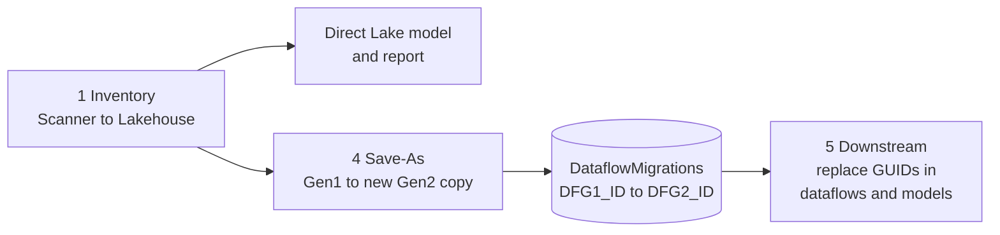
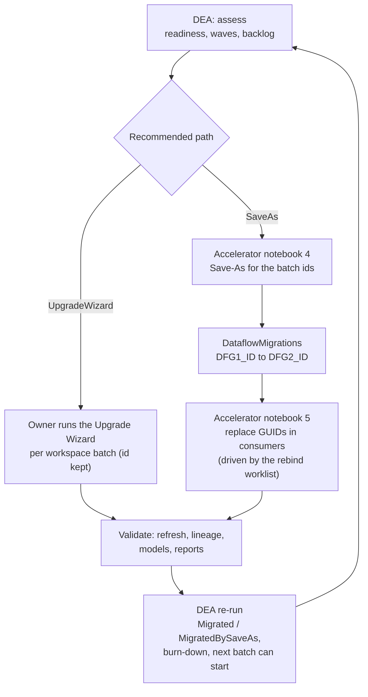

# Review of the Microsoft DFG2 migration accelerator

Reviewed: [`microsoft/fabric-toolbox`, `accelerators/DFG2-migration-accelerator`](https://github.com/microsoft/fabric-toolbox/tree/29264d36e5fdf483498faf97013ecf4dd0bd8a10/accelerators/DFG2-migration-accelerator)
at commit `29264d3` (the folder is identical on `main` at the time of the review). It is an **execution** accelerator: it inventories Gen1 dataflows, converts them with the
Save-As API and re-points downstream items. DEA is an **assessment** framework: it decides what to migrate, how and in which order. They are complementary and share the
same Lakehouse conventions.

## 1. What the accelerator contains

| Item | Role |
|---|---|
| Bootstrap notebook | creates a schema-enabled Lakehouse (`DFG2_Migration`) and deploys the items below from `DFG2_Migration_Items.json`, replacing placeholder GUIDs and following long-running operations |
| `Notebook_1_Dataflow_Inventory` | Scanner-based inventory: `modified` -> `getInfo` (all lineage / datasource / user / schema flags) -> `scanStatus` -> `scanResult`; writes `ScanResults`, `Dataflows`, `Datasets` (all columns as strings, overwritten each run) and the raw JSON under `Files/Scanner_API/` |
| `Notebook_4_Create_DFG2s_from_DFG1s` | selects Gen1 dataflows on dedicated capacity and calls `POST groups/{ws}/dataflows/{id}/saveAsNativeArtifact` (`displayName`, `description`, `includeSchedule`) in a thread pool; appends one row per attempt to `DataflowMigrations` (`DFG1_Name`, `DFG1_Desc`, `DFG1_ID`, `Workspace_ID`, `DFG2_Name`, `DFG2_Desc`, `DFG2_ID`, `Result`, `StatusCode`, `StatusText`) |
| `Notebook_5_Create_or_Update_Downstream_Items` | reads item definitions (`getDefinition`), replaces old GUIDs with the new ones in dataflows and semantic models (`updateDefinition` or create) in parallel |
| `SemanticModel_2_Inventory_Model`, `Report_3_Inventory_Report` | a Direct Lake model over the inventory tables and a one-page report |



## 2. Strengths worth keeping

* Scanner-based discovery with the **real payload fields** (`generation`, `refreshSchedule`, `tags`, `configuredBy`, `sensitivityLabel`, `upstreamDataflows`, `datasourceUsages`,
  datasets with `targetStorageMode`), including fields the public documentation omits.
* A concrete, API-driven Save-As path with an **audit table** of old and new ids.
* A proven way to **re-point downstream items** by replacing identifiers in their definitions.
* A Direct Lake model and report as a starting point for reporting.

## 3. Gaps for an enterprise programme (observed in the reviewed version)

| Area | Observation | Consequence |
|---|---|---|
| Decision support | no readiness class, complexity, effort, lineage closure, wave planning or recommendation | the team still has to decide what to convert and in which order |
| Eligibility | filter on Gen1 and dedicated capacity only | dataflows with bring-your-own storage, incremental refresh, DirectQuery consumers, linked entities, name collisions or unresolved connections are converted blindly |
| Throttling | plain `requests` calls, no `429` handling, no scan concurrency cap (the Scanner allows 16 concurrent scans) | large tenants hit throttling and lose work |
| Incremental / restart | full re-inventory and full overwrite on each run, no checkpoints | no resume, no incremental harvest, no history |
| Data model | every column stored as a string, tables overwritten | no typed analytics, no history, no soft deletes |
| Refresh and health | no refresh history, durations or failure analysis | a failing Gen1 dataflow is migrated as is |
| Rebind scope | consumers are discovered inside the notebook at run time | no worklist, no effort estimate, no visibility before the migration |

## 4. What DEA adopted from it

| Idea | In DEA |
|---|---|
| Scanner first, with the real field names | Section 3 (`scan`) and `parse_scan_result`: `generation`, `refreshSchedule`, `tags`, `configuredBy`, `sensitivityLabel`, `upstreamDataflows`, `datasourceUsages`, dataset `targetStorageMode`; generic parsing tolerant of undocumented arrays |
| Save-As semantics | rules `CAP-001` (Premium / Fabric capacity needed), `INC-001` (incremental refresh must be recreated), `SCH-002` (schedule copied **disabled**), `REB-001` (new id: consumers re-pointed), `STO-001`, `ECE-001`, `DQ-001`, `AIX-001` (not copied) |
| Two migration paths | every rule has an effect for the **Upgrade Wizard** (id kept) and for **Save-As** (new id); the recommended path and the effort differ accordingly |
| Audit table of old and new ids | `p_migration_results_table` (`dataflowmigrations`) is **read** by the analysis: Gen1 dataflows become `MigratedBySaveAs` with `gen2_dataflow_id`, the copy becomes `SaveAsCopy`, failures become `SaveAsFailed`; planned dataflows exclude the migrated ones |
| Downstream re-pointing | `Assessment_RebindWorklist` lists, before and after the migration, every consumer to re-point (dataflows, semantic models, datamarts, pipelines), with the legacy `PowerBI.Dataflows` connector flagged (`LNK-003`) and a Gen2 id when known |
| Direct Lake reporting | recommended model on the Gold tables ([02-lakehouse-model.md](02-lakehouse-model.md#5-semantic-model-recommendation-direct-lake)) |
| Same Lakehouse conventions | schema `dbo`, Delta tables, Scanner JSON kept in `Files`; DEA tables are prefixed `Assessment_` so both solutions can share one Lakehouse |

What DEA adds: typed tables with history and soft deletes, 429-aware rate limiting, checkpoints and incremental runs, refresh history, M analysis of definitions, readiness and
complexity scoring, dependency closure and cycles, waves and batches, governance overrides, KPI burn-down, and a notebook-level test suite.

## 5. Working together



Use the **Upgrade Wizard** whenever the readiness allows it: the id and name are kept, so semantic models and reports keep working and only linked dataflows need to be
opened and saved. Use **Save-As** when the wizard is unavailable or blocked, when you need API automation, or to build a Gen2 copy next to the original for side-by-side validation;
budget for the rebind work (it is in `Assessment_RebindWorklist`) and for recreating incremental refresh, re-enabling schedules and moving API-based triggers to the Fabric job scheduler.

### Hand-off: run the accelerator on a DEA batch

The accelerator selects the dataflows to convert from its own `dataflows` table. Restrict that selection to the work queue of DEA (adapt the column names to your copy of the
notebook):

```python
# DEA backlog: Save-As candidates of wave 1 that can start now
batch = (spark.table("dbo.Assessment_MigrationBacklog")
         .filter("recommended_path = 'SaveAs' AND can_start_now AND wave = 1")
         .select("dataflow_id").toPandas()["dataflow_id"].str.lower())

# accelerator notebook 4, where the Gen1 dataflows are loaded
dfs = spark.read.format("delta").load("Tables/dbo/dataflows").toPandas()
dfs = dfs[dfs["objectId"].str.lower().isin(batch)]
```

After the accelerator has written `dbo.dataflowmigrations`, run DEA in `incremental` or `analysis_only` mode: the table is picked up automatically (`p_migration_results_table`;
leave it at the default when both solutions share the Lakehouse and schema). Then work through `Assessment_RebindWorklist` (or feed the old to new id pairs to the accelerator's
downstream notebook), validate, and re-run.

How the results table is read, defensively because it is written by another tool:

* A row is a success only when `Result` says Succeed **and** `DFG2_ID` is a real id; placeholders such as `NA`, `null` or `0` are not ids. A Succeed row without a usable id is an attempt
  without a copy and shows as `SaveAsFailed`, not as `NotStarted`. A success is never overwritten by a later failure.
* Save-As is not idempotent, so one Gen1 dataflow can have several successful copies. The primary copy is the one found in the Gen2 inventory, otherwise the smallest id; the
  status row notes the other copies and a copy that is in the table but not in the inventory.
* Gen2 copies found in the inventory are marked `SaveAsCopy` and excluded from the plan; Gen1 dataflows with a verified copy become `MigratedBySaveAs`.

### Caveats that apply to both

* `saveAsNativeArtifact` and the Upgrade Wizard are preview features at the time of writing: check the current documentation before each wave.
* Save-As is not idempotent (each call creates a new copy), needs a Premium or Fabric capacity, and does not carry over incremental refresh configuration, bring-your-own storage,
  enhanced compute, DirectQuery, AI insights or endorsements. The schedule is copied disabled.
* The Gen2 copy has a **new id**: Power Automate flows, scripts and pipelines that call the refresh APIs must be updated (`TRG-001`, `PIP-001`).
