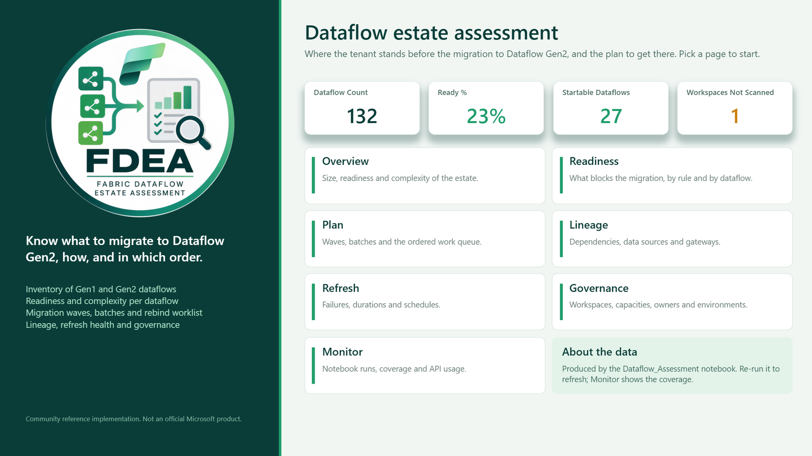
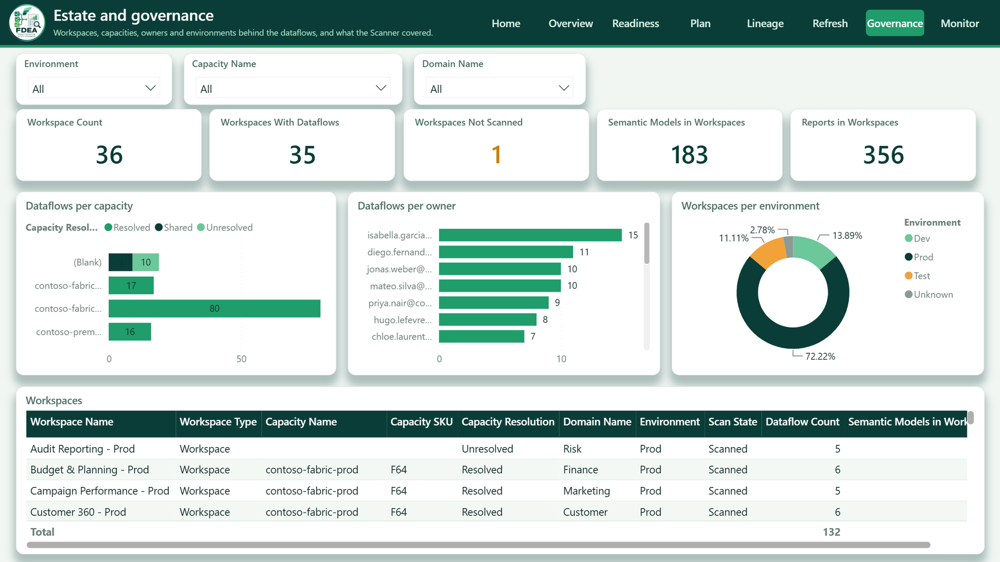

# Power BI report

A Direct Lake semantic model and a report (a home page and seven analysis pages) over the Lakehouse tables written by the notebook. The model and the page content are generated from the notebook schema registry by
[`tools/build_powerbi.py`](../tools/build_powerbi.py) into [`powerbi/`](../powerbi), as a Power BI project (PBIP: TMDL for the model, PBIR for the report), so it opens in Power BI Desktop
and goes through Git and deployment pipelines like any other project.

The visual design is a layer on top of the generated report: the **FDEA theme** (`powerbi/DataflowAssessment.Report/StaticResources/RegisteredResources/FDEA.theme.json`, palette taken from the logo),
the header band with the logo (`fdea-badge.png`, the logo on a white disc so that it reads on the dark band) and the page navigator, the semantic colors (readiness, severity, complexity, criticality) and the *Home* page. Regenerating the pages overwrites this layer unless the generator reapplies it.

## Pages

| Page | Question it answers | Main visuals |
|---|---|---|
| **Home** | Where do I start? | key figures (dataflows, ready share, startable dataflows, workspaces not scanned) and a tile per page |
| **Overview** | How big is the estate and how ready is it? | dataflows, Gen1 / Gen2, ready share, average complexity, **workspaces not scanned**; readiness, wave, path, complexity band, criticality; average complexity per workspace |
| **Readiness** (blockers) | What stops the migration and how do I fix it? | findings by feature and severity, readiness by workspace, findings table with evidence and remediation |
| **Plan** (migration plan) | In which order, by whom, how much work? | startable and blocked dataflows, dataflows per wave, batches (wave x workspace), the ordered work queue |
| **Lineage** (dependencies and sources) | Who depends on whom, and on which sources and gateways? | related assets by type and direction, cross-workspace links and cycles, sources by category and connector, hosts and credential types |
| **Refresh** (refresh health) | Which dataflows fail, and when? | runs per day by status, failed runs per dataflow, schedules, executions and error messages |
| **Governance** (estate) | Which workspaces, capacities, owners, environments? | dataflows per capacity and owner, environments, workspace table with scan state |
| **Monitor** (run monitor) | Did the notebook cover the tenant? | readiness trend over the runs, API calls and errors per run, run table |

The **Workspaces Not Scanned** card is the data-quality indicator: while it is not 0, some dataflows may be missing or incomplete (sources, gateways, lineage come from the Scanner).

The screenshots use fictitious data (a Contoso-style tenant, see the [README](../README.md#sample-outputs)). The *Overview*, *Readiness*, *Plan*, *Lineage*, *Refresh* and *Monitor* pages are shown there; these are the *Home* and *Governance* pages.





## Model

| Table | Lakehouse table | Role |
|---|---|---|
| Dataflows | `assessment_dataflowsummary` | central table, one row per dataflow; most measures live here |
| Workspaces | `assessment_workspaces` | workspace dimension (including workspaces without dataflows) |
| Unsupported Features, Rules | `assessment_unsupportedfeatures`, `assessment_rulecatalog` | findings and the rule catalog |
| Migration Backlog, Wave Plan | `assessment_migrationbacklog`, `assessment_waveplan` | execution order and batches |
| Dependencies, Data Sources | `assessment_dataflowdependencies`, `assessment_dataflowsources` | lineage and connectivity |
| Refresh History, Run History | `assessment_refreshhistory`, `assessment_runsummary` | operations and monitoring |

Eight many-to-one relationships (on `dataflow_id`, `workspace_id` and `rule_id`), 62 explicit measures (`discourageImplicitMeasures`) plus one hidden card measure, keys and the numbers read through measures are hidden.
The count cards show 0 rather than *(Blank)*: seven of the card measures wrap their result in `COALESCE(..., 0)`, and `Failed Runs (card)` is the card-only twin of `Failed Runs`, which also feeds a chart where a 0 would list every dataflow.
Direct Lake on OneLake: no import, no copy. Arrays (`tags`, `blocked_by`, `top_actions`, ...) are not supported by Direct Lake and are left out; the Excel workbook of the run keeps them.

## Use it

```powershell
# 1. the ids of the workspace and the Lakehouse the notebook writes to
python tools/build_powerbi.py --workspace-id <workspace guid> --lakehouse-id <lakehouse guid>

# 2a. open powerbi/DataflowAssessment.pbip in Power BI Desktop, or
# 2b. deploy the semantic model and the report to the workspace (az login first)
python tools/deploy_powerbi.py --workspace-id <workspace guid>
```

After each notebook run the Direct Lake model must be *framed* again to see the new data: it happens automatically when the model keeps its default "keep Direct Lake data up to date" setting,
otherwise refresh the semantic model (the notebook can be followed by a semantic model refresh activity in the pipeline). `python tools/build_powerbi.py --check` (and the test suite) fails
when the project is out of date with the registry.

## Verification

The model and the report were deployed and checked against a real run: all measures were evaluated with DAX queries and every visual's field combination was executed as a query; the
report files are validated against Microsoft's PBIR schemas. The rendering itself (colours, spacing) was not inspected: the export-to-image API is disabled on the tenant it was tested on.

## Limits

* The complexity band has no numeric order column, so its visuals are donuts (no wrong alphabetical ordering).
* Personal workspaces are listed in Workspaces; filter on `Is Personal` if they are not wanted.
* A new column in the registry is not added to the model automatically: add it to `SPEC` in the generator.
